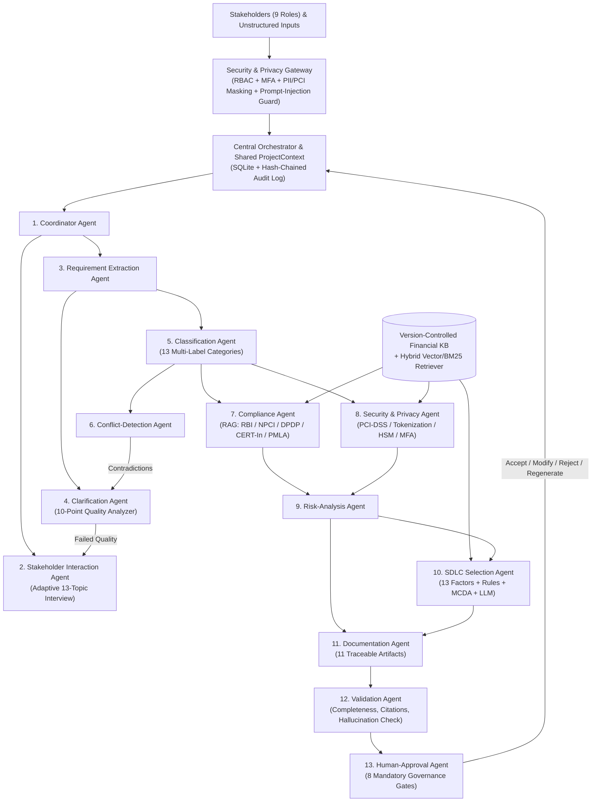

# FinReq AI: Agentic AI System for Financial Requirement Engineering & SDLC Selection

**Domain Focus:** Payment Processing & Fraud Detection (India: RBI, NPCI/UPI, DPDP Act 2023, PMLA/FIU-IND, CERT-In, PCI-DSS v4.0)

## 1. System Overview

FinReq AI is an autonomous, human-governed multi-agent platform for requirement elicitation, quality verification, regulatory compliance mapping, risk analysis, artifact generation, and SDLC selection in Indian payment systems and fraud-detection engineering.

## 2. Architecture Components

| Layer | Technology | Responsibility |
|-------|------------|----------------|
| **Web Frontend** | React 19 + TypeScript + Vite | Multi-role workspace, adaptive interview console, document/transcript ingestion with live PII masking preview, requirement workbench, compliance & risk matrices, ranked SDLC dashboard, HITL approval queue, evaluation benchmark view, and audit log viewer |
| **API & Orchestration** | Python 3.12 + FastAPI | REST + streaming endpoints, 13-agent orchestrator, state machine, RBAC/MFA session guard, immutable audit trail |
| **LLM Abstraction** | Pluggable Provider (`backend/llm/provider.py`) | Unified adapter supporting **Google Gemini**, **OpenAI**, **Local Ollama**, and a **Deterministic Grounded Fallback** when running offline or without API keys |
| **Knowledge & RAG** | Hybrid Vector (TF-IDF/SVD + optional Dense Embeddings) + BM25 + Allowlist Registry | Version-controlled Indian regulatory & domain KB with source, jurisdiction, effective date, version, applicability, citation verification, and confidence scoring |
| **Persistence & Audit** | SQLite (`backend/db/database.py`) | Structured requirements, stakeholder sessions, masked inputs, compliance/risk mappings, SDLC decisions, HITL gates, and SHA-256 hash-chained audit logs |
| **SDLC Engine** | Rules + MCDA + LLM Explanation (`backend/sdlc/engine.py`) | Derives 13 decision factors, ranks 7 SDLC methodologies, and generates customized phase/gate/role/control workflows |
| **Evaluation Suite** | Automated Benchmark (`backend/evaluation/benchmark.py`) | Evaluates extraction P/R/F1, completeness, ambiguity/conflict accuracy, regulatory coverage, hallucination rate, citation correctness, SDLC accuracy, traceability, and time saved vs manual RE |

## 3. Security & Governance Controls (Item 17)

- **Role-Based Access Control (RBAC) & Simulated MFA:** 9 stakeholder roles mapped to granular permissions (e.g., only `Compliance Officer` / `Legal` can approve regulatory determinations; only `Architect` / `PM` / `Security` / `Compliance` can sign off SDLC selection).
- **Pre-LLM PII & PCI Masking:** Regex + Luhn + contextual detectors redact Aadhaar, PAN, card PANs, CVVs, UPI VPAs, IFSCs, bank account numbers, mobile numbers, emails, and bearer secrets before any prompt reaches an LLM.
- **Prompt-Injection Defense:** Detects and blocks/quarantines override instructions, role spoofing, delimiter escapes, and system-prompt extraction attempts; treats ingested stakeholder inputs strictly as untrusted data blocks.
- **Retrieval Allowlisting & Citation Verification:** Only `approved=True` KB items enter the retrieval index; post-generation verification flags any unverified or fabricated citation as a potential hallucination and routes it to human review.
- **Agent Least Privilege:** Every agent has an explicit permission profile restricting which tools, data fields, and state mutations it may perform.
- **Immutable Audit Trail:** Every prompt summary, retrieved KB IDs, agent output, confidence score, user edit, and HITL approval is appended to an audit ledger with chained SHA-256 hashes.
